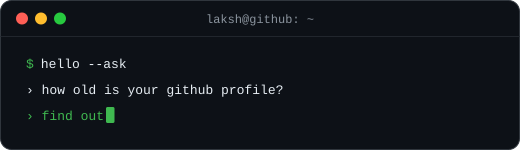

# laksh

· building [vessel](https://github.com/attentionfs/vessel) and a handful of other things ·

[website](https://laaaaksh.github.io/)

 

· open source ·

| repo | what it does | stars |
|---|---|---|
| [escalight](https://github.com/attentionfs/escalight) | self-hosted on-call escalation and paging, one binary and one sqlite file |  |
| [pageflag](https://github.com/attentionfs/pageflag) | click anything on a live page, leave a comment, triage it in a dashboard |  |
| [changeflare](https://github.com/attentionfs/changeflare) | an embeddable "what's new" widget with an unread badge and real analytics |  |
| [pilestack](https://github.com/attentionfs/pilestack) | stacked pull-request review, without the saas |  |
| [diffboard](https://github.com/attentionfs/diffboard) | visual regression testing with a review dashboard |  |
| [clipfolio](https://github.com/attentionfs/clipfolio) | business video hosting with retention curves and lead capture |  |
| [perfnest](https://github.com/attentionfs/perfnest) | scheduled lighthouse runs with performance budgets and alerting |  |
| [seatkey](https://github.com/attentionfs/seatkey) | license-key issuance and activation for indie software |  |
| [leakboard](https://github.com/attentionfs/leakboard) | self-hosted secret scanning across your github org |  |
| [shufflebase](https://github.com/attentionfs/shufflebase) | schema-aware synthetic test data and masking for postgres and mysql |  |

